<p align="center">
  
</p>

# CLVs.jl

CLVs.jl computes the covariant Lyapunov vectors (CLVs) of a trajectory of a dynamical system,
together with the adjoint CLVs, the basis dual to them. It implements the method based on an LU
factorisation of Kuptsov and Parlitz (2012, section 5.2). A set of tangent vectors is marched
forward along the trajectory and a set of adjoint vectors is marched backward, both
re-orthonormalised at short intervals, and at each time of a window the two sets are combined into
the CLVs and their adjoints. The trajectory and the linearised equations are integrated with
[Flows.jl](https://github.com/Davide-Lasagna-s-Lab/Flows.jl). The method needs only the action of
the tangent and of the adjoint equations on vectors. The package is therefore suited to the large
systems that arise from the discretisation of partial differential equations.

The CLVs are the directions that the linearised dynamics maps onto themselves, each growing or
decaying at the rate of one Lyapunov exponent. They span the unstable, neutral and stable subspaces
of the trajectory, and the angles between them measure its hyperbolicity (Ginelli et al. 2007). The
adjoint CLVs give the component of a perturbation along each CLV, and are the projectors onto these
subspaces. They follow from the same factorisation as the CLVs, with no additional integration.

For periodic orbits, where the CLVs are the Floquet vectors, see
[Floquet.jl](https://github.com/Davide-Lasagna-s-Lab/Floquet.jl).


## Covariant Lyapunov vectors

We consider dynamical systems of the form

```math
\dot u = f(u), \qquad u \in X,
```

where the state space $X$ is a real vector space of dimension $n$ with inner product
$\langle \cdot, \cdot \rangle$, the function `dot` in the code. Let $u(t)$ be a trajectory. Small
perturbations $y$ of the trajectory obey the tangent equations

```math
\dot y = J(t)\, y, \qquad J(t) = \mathrm{D}f(u(t)),
```

whose solutions are $y(t) = Y(t, s) y(s)$, with $Y(t, s)$ the propagator from time $s$ to time $t$.

Let $\lambda_1 \gt \lambda_2 \gt \dots \gt \lambda_n$ be the Lyapunov exponents of the trajectory,
which we take as distinct. The covariant Lyapunov vectors $\gamma_1(t), \dots, \gamma_n(t)$ are unit
vectors, a basis of $X$ at every time, that the propagator maps onto themselves,

```math
Y(t, s)\, \gamma_j(s) = \mu_j(t, s)\, \gamma_j(t) ,
```

and that grow at the rate of their exponent in both directions of time,

```math
\frac{1}{t - s} \log \lvert \mu_j(t, s) \rvert \to \lambda_j
\qquad \text{as } t \to \infty \text{ and as } s \to -\infty .
```

The first property is covariance. It makes the CLVs intrinsic to the trajectory: they do not depend
on the inner product, and they are not orthogonal to each other. The direction of the flow is one of
the CLVs, since $Y(t, s) f(u(s)) = f(u(t))$, and on a chaotic attractor its exponent is zero. The
first $j$ vectors span the $j$ directions that grow fastest forward in time, and the vectors from
the $j$-th to the last span the perturbations that grow no faster than $e^{\lambda_j t}$.

<p align="center">
  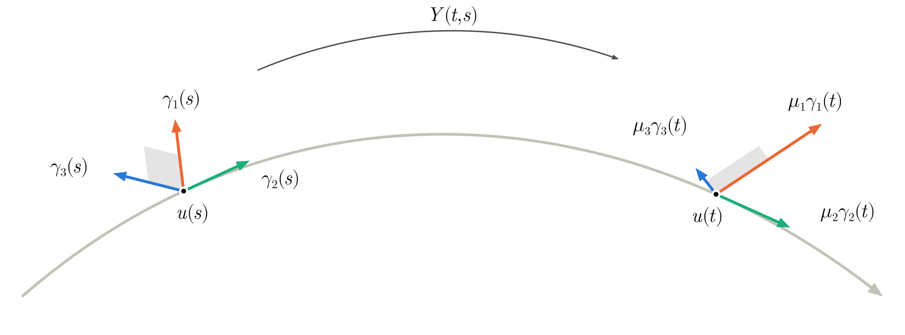
</p>

The figure shows the three CLVs of a trajectory at two times. The propagator maps each vector at
time $s$ onto a multiple of the vector with the same index at time $t$. Here it stretches the first,
shortens the third, and leaves the second, the direction of the flow, along the trajectory. A cell
of perturbations with its sides along the first and the third CLV, in grey, is mapped onto a cell
with its sides along the same two CLVs at the later time, longer and thinner. In all the figures of
this manual the first, second and third vector of a family are orange, green and blue.


## Adjoint covariant Lyapunov vectors

The adjoint equations

```math
-\dot w = J(t)^{\top} w,
```

in which $\top$ denotes the adjoint in $\langle \cdot, \cdot \rangle$, conserve the inner product
$\langle w(t), y(t) \rangle$ with any solution of the tangent equations. Their solutions march
backward in time, $w(s) = Y(t, s)^{\top} w(t)$ for $t \ge s$.

The adjoint CLVs $\theta_1(t), \dots, \theta_n(t)$ are the basis dual to the CLVs,

```math
\langle \theta_i(t), \gamma_j(t) \rangle = \delta_{ij} .
```

They are covariant under the adjoint equations, with the growth factors of the CLVs,

```math
Y(t, s)^{\top} \theta_i(t) = \mu_i(t, s)\, \theta_i(s) .
```

Indeed, for every $j$,

```math
\langle Y(t, s)^{\top} \theta_i(t), \gamma_j(s) \rangle
= \langle \theta_i(t), Y(t, s)\, \gamma_j(s) \rangle
= \mu_j(t, s)\, \langle \theta_i(t), \gamma_j(t) \rangle
= \mu_i(t, s)\, \delta_{ij} ,
```

which is also $\langle \mu_i(t, s) \theta_i(s), \gamma_j(s) \rangle$, and the vectors $\gamma_j(s)$
are a basis. An adjoint solution along $\theta_i$, marched backward from $t$ to $s$, therefore grows
as $e^{\lambda_i (t - s)}$. The adjoint CLVs have the exponents of the CLVs, with time reversed.

Three properties follow from the duality. First, any perturbation decomposes on the CLVs with the
adjoint CLVs as coefficients,

```math
y = \sum_{j=1}^{n} \langle \theta_j, y \rangle\, \gamma_j .
```

The map $y \mapsto \langle \theta_j, y \rangle \gamma_j$ is the projector onto $\gamma_j$ along all
the other CLVs, and the sum of these maps over the unstable vectors is the projector onto the
unstable subspace. Second, the vector $\theta_i$ is orthogonal to all the CLVs but $\gamma_i$. It is
the normal to the hyperplane that they span, and

```math
\mathrm{span}(\theta_1, \dots, \theta_j) = \mathrm{span}(\gamma_{j+1}, \dots, \gamma_n)^{\perp} .
```

Third, unlike the CLVs, the adjoint CLVs depend on the inner product. If
$\langle u, v \rangle = (u, W v)$, with $(\cdot, \cdot)$ the Euclidean product and $W$ symmetric
positive definite, they are $W^{-1}$ times those of the Euclidean product.

<p align="center">
  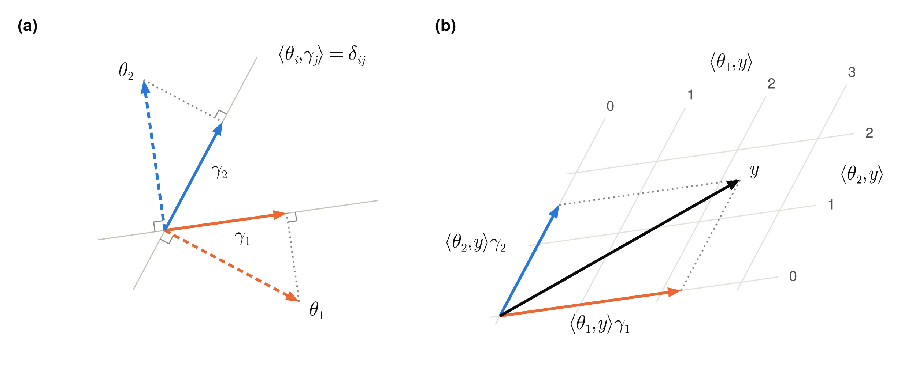
</p>

The figure shows the two bases in the plane. The CLVs are drawn with solid lines and their adjoints
with dashed lines, as are the tangent and the adjoint vectors in all the figures. In panel (a),
$\theta_1$ is normal to $\gamma_2$ and $\theta_2$ to $\gamma_1$. The length of each adjoint is such
that the foot of the normal from its tip to its own CLV is the tip of that CLV, along the dotted
lines, which is the condition $\langle \theta_i, \gamma_i \rangle = 1$. The adjoint is therefore
longer than its CLV, the more so the smaller the angle between the two CLVs. In panel (b), a
perturbation $y$ is the sum of its components along the two CLVs. The lines of constant
$\langle \theta_1, y \rangle$ are parallel to $\gamma_2$, so that this inner product is the
coordinate of $y$ along $\gamma_1$ in the oblique grid of the CLVs, and likewise for
$\langle \theta_2, y \rangle$.


## The two sets of Gram–Schmidt vectors

CLVs.jl marches $N \le n$ tangent vectors forward in time and $N$ adjoint vectors backward, and
re-orthonormalises each set by the Gram–Schmidt procedure at regular intervals, as in the
computation of the Lyapunov exponents of Benettin et al. (1980). Let
$\psi_1^-(t), \dots, \psi_N^-(t)$ be the tangent set and $\psi_1^+(t), \dots, \psi_N^+(t)$ the
adjoint set at time $t$, `ψ⁻` and `ψ⁺` in the code. At time $t$ the first set depends on the past of
the trajectory and the second on its future, and Kuptsov and Parlitz (2012) call them the backward
and the forward Lyapunov vectors.

The Gram–Schmidt procedure does not change the span of the first $j$ vectors of a set, and $j$
generic tangent vectors align with the $j$ directions that grow fastest. After a spin-up,

```math
\mathrm{span}(\psi_1^-, \dots, \psi_j^-) = \mathrm{span}(\gamma_1, \dots, \gamma_j),
\qquad j = 1, \dots, N,
```

up to an error that decays as $e^{-(\lambda_j - \lambda_{j+1}) \tau}$ with the length $\tau$ of the
spin-up. By the covariance of the adjoint CLVs, the adjoint solutions that grow fastest backward in
time are those along $\theta_1, \theta_2, \dots$, in this order, and the same argument gives

```math
\mathrm{span}(\psi_1^+, \dots, \psi_j^+) = \mathrm{span}(\theta_1, \dots, \theta_j)
= \mathrm{span}(\gamma_{j+1}, \dots, \gamma_n)^{\perp},
\qquad j = 1, \dots, N.
```

<p align="center">
  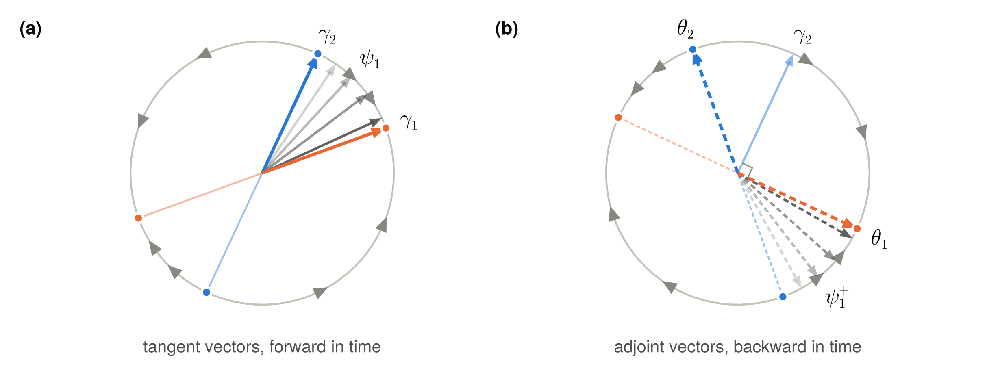
</p>

The figure shows the two convergences for a system of the plane with a constant Jacobian, on the
circle of the directions. In panel (a), forward in time, every tangent vector that is not along
$\gamma_2$ turns to $\gamma_1$, as the grey vector $\psi_1^-$ does, drawn at four times from light
to dark. In panel (b), backward in time, every adjoint vector that is not along $\theta_2$ turns to
$\theta_1$, which is normal to $\gamma_2$. The first vector of the tangent set gives $\gamma_1$, and
the normal to the first vector of the adjoint set gives $\gamma_2$.

The adjoint Gram–Schmidt vectors are to the adjoint CLVs what the tangent ones are to the CLVs. The
vector $\gamma_j$ lies in the span of $\psi_1^-, \dots, \psi_j^-$ and is orthogonal to
$\psi_1^+, \dots, \psi_{j-1}^+$, and the vector $\theta_j$ lies in the span of
$\psi_1^+, \dots, \psi_j^+$ and is orthogonal to $\psi_1^-, \dots, \psi_{j-1}^-$. Each pair of
conditions leaves one direction. The CLVs were obtained from these intersections by Wolfe and
Samelson (2007), and by Ginelli et al. (2007) with an iteration backward in time that needs the
tangent set only. The second set is needed here because it also gives the adjoint CLVs.

<p align="center">
  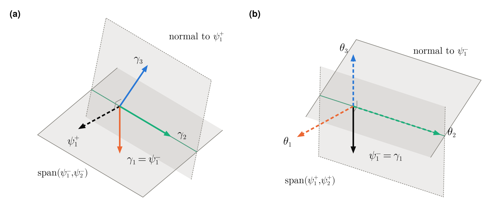
</p>

The figure shows the two intersections for the second vector of each family in three dimensions. In
panel (a), $\gamma_2$ lies in the plane of $\psi_1^-$ and $\psi_2^-$, which is that of $\gamma_1$
and $\gamma_2$, and in the plane normal to $\psi_1^+$, which is that of $\gamma_2$ and $\gamma_3$.
In panel (b), with the two sets exchanged, $\theta_2$ lies in the plane of $\psi_1^+$ and $\psi_2^+$
and in the plane normal to $\psi_1^-$. The vectors of the two panels are dual to each other.


## The LU factorisation

At each time of the window the two sets of Gram–Schmidt vectors are known. The CLVs and their
adjoints follow from them with the factorisation of one matrix of size $N$, which this section
derives in three steps. All the vectors are taken at the same time.

**Matrices of vectors.** The $N$ vectors of a set, or of a family, are collected as the columns of a
matrix,

```math
\Psi^- = \begin{bmatrix} \psi_1^- & \cdots & \psi_N^- \end{bmatrix} , \qquad
\Psi^+ = \begin{bmatrix} \psi_1^+ & \cdots & \psi_N^+ \end{bmatrix} ,
```

for the tangent and the adjoint set, and

```math
\Gamma = \begin{bmatrix} \gamma_1 & \cdots & \gamma_N \end{bmatrix} , \qquad
\Theta = \begin{bmatrix} \theta_1 & \cdots & \theta_N \end{bmatrix} ,
```

for the first $N$ CLVs and their adjoints. Each matrix has $n$ rows, one for each component of the
state, and $N$ columns. Two operations on these matrices are needed. The product $\Psi^- A$ with a
matrix $A$ of size $N$ combines the vectors: its column $j$ is $\sum_k A_{kj} \psi_k^-$. The product
$\Psi^{+\top} \Psi^-$ of two of them is the matrix of size $N$ of their inner products, of entries
$\langle \psi_i^+, \psi_j^- \rangle$. In this notation the duality of the two families reads
$\Theta^{\top} \Gamma = I$. The code holds each of these matrices as a `Coupled` object of `N`
states, and only ever combines the states and takes their inner products.

**Step 1: the vectors are triangular combinations of the two sets.** By the spans of the previous
section, $\gamma_j$ lies in the span of the first $j$ vectors of the tangent set, and $\theta_j$ in
that of the first $j$ vectors of the adjoint set,

```math
\gamma_j = \sum_{k=1}^{j} A_{kj} \psi_k^- , \qquad
\theta_j = \sum_{k=1}^{j} B_{kj} \psi_k^+ , \qquad j = 1, \dots, N .
```

No vector of index larger than $j$ enters. The coefficients therefore fill two upper triangular
matrices $A$ and $B$ of size $N$, and the two sums read

```math
\Gamma = \Psi^- A , \qquad \Theta = \Psi^+ B .
```

These coefficients are the unknowns.

**Step 2: the duality gives their equations.** The two families are dual, so that $\theta_i$ is
orthogonal to $\gamma_j$ for $i \ne j$. Let

```math
P = \Psi^{+\top} \Psi^- , \qquad P_{ij} = \langle \psi_i^+, \psi_j^- \rangle ,
```

be the matrix of the inner products between the two sets. It is the only quantity that involves the
states, through $N^2$ inner products. The inner products between the two families are those between
the two sets, combined with the coefficients, and the orthogonality reads

```math
\Theta^{\top} \Gamma = B^{\top} \Psi^{+\top} \Psi^- A = B^{\top} P A = D ,
```

where $D$ is a diagonal matrix, of entries $\langle \theta_j, \gamma_j \rangle$.

**Step 3: these equations are an LU factorisation.** Solved for $P$, they read

```math
P = B^{-\top} D A^{-1} .
```

The inverse of an upper triangular matrix is upper triangular, and its transpose is lower
triangular. The matrix $P$ is thus the product of a lower triangular matrix, a diagonal one and an
upper triangular one, which is its LU factorisation without pivoting,

```math
P = L U ,
```

with $L$ lower triangular with ones on its diagonal and $U$ upper triangular. This factorisation is
unique. The matrices $A$ and $B$ are therefore known up to a factor for each of their columns, that
is up to the length of each vector, which the orthogonality does not set. The choice $A = U^{-1}$
and $B = L^{-\top}$ gives

```math
\tilde\Gamma = \Psi^- U^{-1} , \qquad \tilde\Theta = \Psi^+ L^{-\top} , \qquad
\tilde\Theta^{\top} \tilde\Gamma = L^{-1} P U^{-1} = I .
```

The columns of $\tilde\Gamma$ and $\tilde\Theta$ are the CLVs and the adjoint CLVs up to their
length, which the tilde marks and the next section sets, and they are dual as they stand. The
factorisation does not pivot, because the order of the nested subspaces carries the information.

<p align="center">
  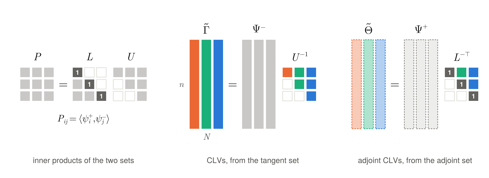
</p>

The figure shows the shapes of the matrices for $N = 3$. The matrices of the vectors are tall, and
the factors are of size $N$. The column $j$ of $U^{-1}$ and of $L^{-\top}$, in the colour of the
vector $j$, holds the coefficients of that vector on the first $j$ vectors of its set. The diagonal
of $L^{-\top}$ is made of ones, so that $\tilde\theta_j$ is $\psi_j^+$ plus a combination of the
vectors before it.

**The case of two vectors.** With $N = 2$ the factors are

```math
L = \begin{bmatrix} 1 & 0 \\ \ell & 1 \end{bmatrix} , \qquad
U = \begin{bmatrix} P_{11} & P_{12} \\ 0 & P_{22} - \ell P_{12} \end{bmatrix} , \qquad
\ell = \frac{P_{21}}{P_{11}} ,
```

and the vectors are

```math
\tilde\gamma_1 = \frac{\psi_1^-}{U_{11}} , \qquad
\tilde\gamma_2 = \frac{1}{U_{22}} \left( \psi_2^- - \frac{P_{12}}{P_{11}} \psi_1^- \right) , \qquad
\tilde\theta_1 = \psi_1^+ , \qquad
\tilde\theta_2 = \psi_2^+ - \frac{P_{21}}{P_{11}} \psi_1^+ .
```

The first vector of each family is the first vector of its set. The second CLV is $\psi_2^-$ less
the multiple of $\psi_1^-$ that makes it orthogonal to $\psi_1^+$: its inner product with $\psi_1^+$
is proportional to $P_{12} - (P_{12}/P_{11}) P_{11}$, which is zero. In the same way, the second
adjoint CLV is $\psi_2^+$ less the multiple of $\psi_1^+$ that makes it orthogonal to $\psi_1^-$.
These are the two intersections of the previous section. With more vectors the elimination goes on
in the same way, and the factorisation is a Gram–Schmidt procedure between the two sets: it makes
each vector of one family orthogonal to the vectors of lower index of the other set.

**Existence.** The factorisation exists if the leading blocks of $P$ are non-singular. The block of
size $j$ is singular only if a non-zero combination of $\gamma_1, \dots, \gamma_j$ is orthogonal to
$\theta_1, \dots, \theta_j$, which the duality excludes. A small pivot $U_{jj}$ signals a near
tangency between the CLVs.

**Fewer vectors than the dimension.** With $N$ smaller than the dimension of the system the vectors
are exact for the $N$ leading exponents. Only the leading block of $P$ enters, and the orthogonality
of $\theta_i$ to the CLVs that are not computed follows from the spans of the adjoint set. The
vectors $\gamma_j$ and $\theta_j$ need the first $j$ vectors of each set.


## Normalisation and transversality

Each CLV is normalised to unit norm, and its adjoint is scaled to keep the duality,

```math
\gamma_j = \frac{\tilde\gamma_j}{\lVert \tilde\gamma_j \rVert} , \qquad
\theta_j = \lVert \tilde\gamma_j \rVert\, \tilde\theta_j , \qquad
\langle \theta_i, \gamma_j \rangle = \delta_{ij} .
```

The decomposition of a perturbation then holds as written above. The length of the adjoint CLV
carries the angle between the two vectors,

```math
c_j = \frac{1}{\lVert \theta_j \rVert} = \cos \angle(\gamma_j, \theta_j) \in (0, 1] .
```

Since $\theta_j$ is normal to the span of all the other CLVs, $c_j$ is also the sine of the angle
between $\gamma_j$ and that span. It equals one when $\gamma_j$ is orthogonal to the other CLVs and
vanishes at a tangency. It is a measure of transversality that needs only the first $j$ vectors of
each set, while the angles between pairs of CLVs need the vectors of both. For the first vector it
is $c_1 = \lvert \langle \psi_1^+, \psi_1^- \rangle \rvert$.

<p align="center">
  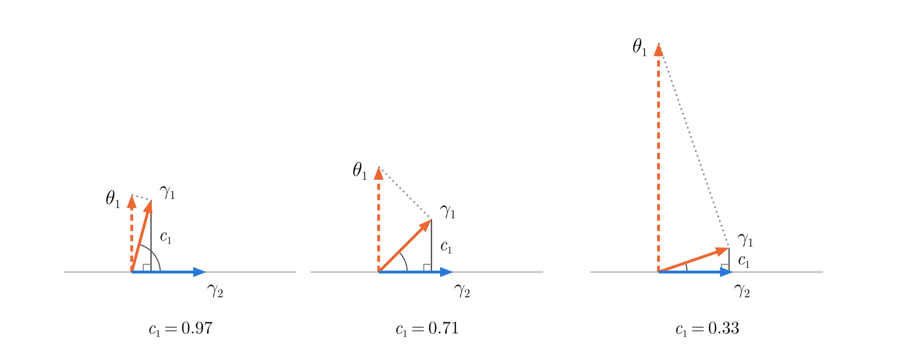
</p>

The figure shows $\gamma_1$ at three angles to the span of the other CLVs, the line of $\gamma_2$ in
the plane. The transversality $c_1$ is the distance of the tip of $\gamma_1$ from this span, and
$\theta_1$, normal to the span, has length $1/c_1$. As $\gamma_1$ approaches the span, $c_1$
vanishes and $\theta_1$ grows without bound.


## The algorithm

The calculation is organised around a window $[t_B, t_C]$ of length $T$, on which the vectors are
wanted, with a spin-up of length $t_{\mathrm{spin}}$ before it for the tangent set and one after it
for the adjoint set.

<p align="center">
  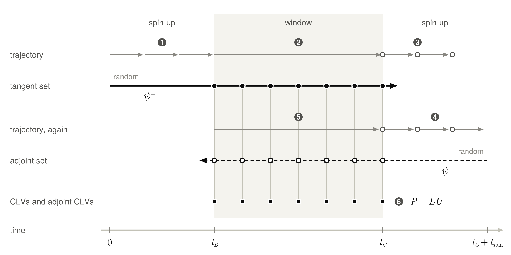
</p>

The numbers in the figure are those of the six steps below. The trajectory is in grey, in the chunks
in which it is integrated, with a circle for each checkpoint. The tangent set is marched forward and
the adjoint set backward, and their samples over the window, the discs and the rings, are combined
at each time.

1. **Forward spin-up.** From the state `x` at time zero, the trajectory is integrated to
   $t_B = t_{\mathrm{spin}}$ in `Nsplits` chunks. The trajectory of each chunk is stored at every
   time step, and the $N$ tangent vectors, random at time zero, are marched along it. They are
   re-orthonormalised by modified Gram–Schmidt every `oneevery` time steps, and at the ends of each
   chunk.
2. **Forward pass.** The trajectory is integrated and stored over the window. The tangent vectors
   are marched along it, and a copy of the orthonormal set is saved every `oneevery` time steps,
   from $t_B$ to $t_C = t_B + T$.
3. **Checkpoints.** The trajectory continues from $t_C$ for the length of the second spin-up, and
   the state at the start of each of its `Nsplits` chunks is saved.
4. **Backward spin-up.** The $N$ adjoint vectors, random at $t_C + t_{\mathrm{spin}}$, are marched
   backward to $t_C$, from the last chunk to the first. The trajectory of each chunk is integrated
   again from its checkpoint and stored.
5. **Backward pass.** The trajectory over the window is integrated again from the state at $t_B$.
   The adjoint vectors are marched from $t_C$ to $t_B$ and saved at the times of the tangent ones.
6. **Recombination.** At each sample the matrix $P$ is formed and factorised, and the two triangular
   factors are inverted. Since $U^{-1}$ and $L^{-\top}$ are upper triangular, the vector $j$ of each
   family needs the vectors from 1 to $j$ of its set. The combinations are done in place, for
   $j = N, N-1, \dots, 1$, with $\gamma_j$ written over $\psi_j^-$ and $\theta_j$ over $\psi_j^+$.

At every time of the window the tangent set has been marched for at least $t_{\mathrm{spin}}$, and
so has the adjoint set, so that both are converged over the whole window.

With $M$ the number of chunks `Nsplits`, the trajectory is integrated over
$3 t_{\mathrm{spin}} + 2T - t_{\mathrm{spin}}/M$ time units, and each of the two sets of $N$ vectors
over $t_{\mathrm{spin}} + T$. Each re-orthonormalisation and each recombination costs of the order
of $N^2$ operations on states. With $\Delta t$ the time step and $K$ the number of sampling
intervals in the window, the memory holds $2N(K + 1)$ states for the samples of the two sets, which
become the two families of vectors, and the trajectory of the window at every time step,
$T/\Delta t$ states, or that of one chunk of the spin-up if longer.


## Installation

CLVs.jl and Flows.jl are not registered. In the package mode of the Julia REPL, add Flows.jl first
and then CLVs.jl, both from GitHub. Flows.jl must be added explicitly, because the `[sources]`
section of the project file of a package is not used when the package is a dependency.

```julia
pkg> add https://github.com/Davide-Lasagna-s-Lab/Flows.jl
pkg> add https://github.com/Davide-Lasagna-s-Lab/CLVs.jl
```

Julia 1.11 or later is required.


## Usage

### The function `computeCLV`

```julia
ts, Γs, Θs = computeCLV(flow_nl, flow_tan, flow_adj, x, randx, tspin, T, Nsplits, N, oneevery=10)
```

The arguments are positional, and are listed in the following table.

| Argument   | Meaning |
|------------|---------|
| `flow_nl`  | Flow of the nonlinear equations, a `Flow` of Flows.jl for one state. |
| `flow_tan` | Flow of the tangent equations for `N` coupled vectors, along a stored trajectory. |
| `flow_adj` | Flow of the adjoint equations for `N` coupled vectors, along a stored trajectory. It marches backward in time. |
| `x`        | State at time zero, where the forward spin-up starts. It is modified. |
| `randx`    | Function without arguments that returns a new random state at every call. It is called `2N` times, for the initial tangent and adjoint vectors. |
| `tspin`    | Length of each of the two spin-ups, of the tangent set before the window and of the adjoint set after it. |
| `T`        | Length of the window. It must be a whole number of sampling intervals, `oneevery` time steps each. |
| `Nsplits`  | Number of chunks of each spin-up. The trajectory of a spin-up is held in memory one chunk at a time. |
| `N`        | Number of vectors of each family. |
| `oneevery` | Number of time steps between two re-orthonormalisations, and between two samples of the output. The default is 10. |

The function returns three objects.

| Output | Content |
|--------|---------|
| `ts`   | The $K + 1$ sample times, from 0 to `T`, measured from the start of the window. |
| `Γs`   | `Γs[i][j]` is the CLV $\gamma_j$ at time `ts[i]`, of unit `norm`. |
| `Θs`   | `Θs[i][j]` is the adjoint CLV $\theta_j$ at time `ts[i]`, with `dot(Θs[i][j], Γs[i][k])` equal to one for `j == k` and to zero otherwise. |

`Γs` and `Θs` are vectors of `Coupled` objects of Flows.jl, each holding `N` states. The vectors are
sorted by decreasing Lyapunov exponent. Their orientation is not defined: it follows that of the
random initial vectors, and $\gamma_j$ and $\theta_j$ change sign together. The function prints the
time taken by each stage of the calculation to `stdout`.

### The three flows

The flows are built with Flows.jl. The tangent and the adjoint equations are given as callables
`ftan(t, u, y, dydt)` and `fadj(t, u, w, dwdt)`. The first writes in `dydt` the Jacobian at the
state `u` applied to the tangent vector `y`. The second writes in `dwdt` the adjoint of the Jacobian
at `u` applied to `w`, that is $J(u)^{\top} w$ and not its negative. The adjoint is taken in the
inner product `dot`. Flows.jl integrates the adjoint equations $-\dot w = J^{\top} w$ backward in
time. The state `u` is interpolated at time `t` from the stored trajectory. For states that are
vectors of length `n`, and with the scheme RK4, the three flows read as follows.

```julia
using Flows

# flow of the nonlinear equations f(t, x, dxdt)
flow_nl = flow(f, RK4(zeros(n)), TimeStepConstant(Δt))

# flows of the tangent and adjoint equations, for N vectors along a stored trajectory
z        = couple(ntuple(i -> zeros(n), N)...)
dep      = CallDependency(ntuple(i -> (i,), N)...)
flow_tan = flow(couple(ntuple(i -> ftan, N)...), dep,
                RK4(z, ContinuousMode(false)), TimeStepFromStorage(Δt))
flow_adj = flow(couple(ntuple(i -> fadj, N)...), dep,
                RK4(z, ContinuousMode(true)), TimeStepFromStorage(Δt))
```

The two linearised flows act on a `Coupled` object of `N` vectors, and run in the continuous mode of
Flows.jl, which reads the trajectory from a storage. `ContinuousMode(true)` selects the adjoint
equations. The call dependency states that each vector is advanced by itself. Flows.jl defines a
default for up to three coupled components only, so that it must be given for larger `N`. The
tangent and adjoint flows must have the same time step. The tangent and adjoint vectors are of the
type of the state.

### The function `angles`

```julia
angles(Γ)
```

returns the $N \times N$ matrix of the angles between the vectors of a `Coupled` object `Γ` of unit
vectors, such as `Γs[i]`. The angles lie in $[0, \pi/2]$, since the orientation of the CLVs is not
defined. The diagonal is zero up to rounding, of about $10^{-8}$.


## Example: the Lorenz equations

This example computes the three CLVs and their adjoints on a chaotic trajectory of the Lorenz
equations, whose Lyapunov exponents are about 0.906, 0 and −14.57.

```julia
using LinearAlgebra
using Random
using Flows
using CLVs

# Lorenz equations, with σ = 10, ρ = 28 and β = 8/3
function lorenz(t, x, dxdt)
    dxdt[1] = 10*(x[2] - x[1])
    dxdt[2] = 28*x[1] - x[2] - x[1]*x[3]
    dxdt[3] = -8/3*x[3] + x[1]*x[2]
    return dxdt
end

# tangent equations, the Jacobian at u applied to the tangent vector y
function lorenz_tan(t, u, y, dydt)
    dydt[1] = 10*(y[2] - y[1])
    dydt[2] = (28 - u[3])*y[1] - y[2] - u[1]*y[3]
    dydt[3] = u[2]*y[1] + u[1]*y[2] - 8/3*y[3]
    return dydt
end

# adjoint equations, the transpose of the Jacobian at u applied to w
function lorenz_adj(t, u, w, dwdt)
    dwdt[1] = -10*w[1] + (28 - u[3])*w[2] + u[2]*w[3]
    dwdt[2] = 10*w[1] - w[2] + u[1]*w[3]
    dwdt[3] = -u[1]*w[2] - 8/3*w[3]
    return dwdt
end

# number of vectors and time step
N  = 3
Δt = 0.005

# flow of the nonlinear equations
flow_nl = flow(lorenz, RK4(zeros(3)), TimeStepConstant(Δt))

# flows of the tangent and adjoint equations, for N vectors along a stored trajectory
z        = couple(ntuple(i -> zeros(3), N)...)
dep      = CallDependency(ntuple(i -> (i,), N)...)
flow_tan = flow(couple(ntuple(i -> lorenz_tan, N)...), dep,
                RK4(z, ContinuousMode(false)), TimeStepFromStorage(Δt))
flow_adj = flow(couple(ntuple(i -> lorenz_adj, N)...), dep,
                RK4(z, ContinuousMode(true)), TimeStepFromStorage(Δt))

# a point on the attractor
x = flow_nl([1.0, 1.0, 20.0], (0, 20))

# CLVs and adjoint CLVs over a window of 50 time units, sampled every 10 time
# steps, after a spin-up of 25 time units in 5 chunks
Random.seed!(0)
ts, Γs, Θs = computeCLV(flow_nl, flow_tan, flow_adj, x, () -> randn(3),
                        25.0, 50.0, 5, N, 10)
```

The window holds 1001 samples, 0.05 time units apart. The two families are dual at every sample.

```julia
julia> length(ts), ts[end]
(1001, 50.0)

julia> [dot(Θs[1][j], Γs[1][k]) for j in 1:3, k in 1:3]
3×3 Matrix{Float64}:
 1.0          9.32845e-17   6.24408e-17
 2.54918e-17  1.0          -1.7187e-17
 3.41768e-17  1.00922e-16   1.0
```

Over the whole window the largest entry of $\Theta^{\top} \Gamma - I$ is $7 \times 10^{-15}$.

<p align="center">
  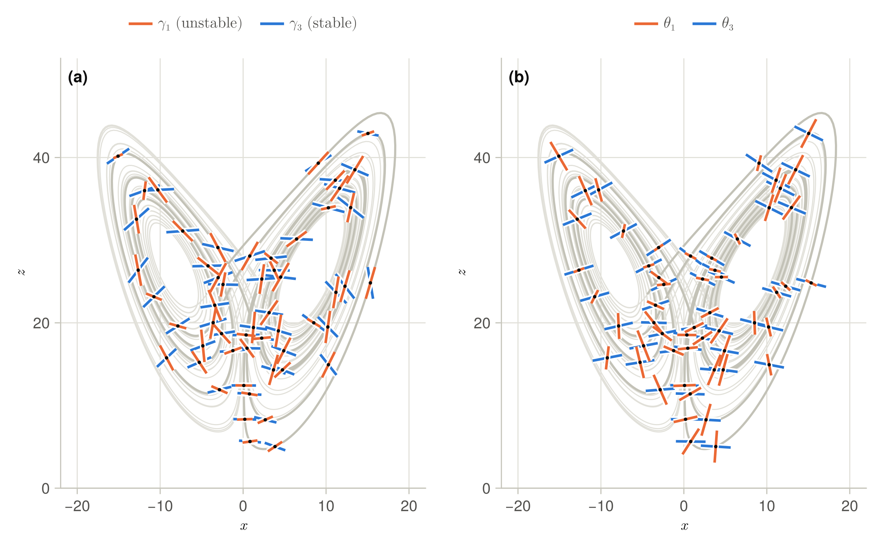
</p>

The figure shows the directions of the unstable and of the stable vector of each family along the
first eight time units of the window, in the plane $(x, z)$, at one sample every three. The whole
window is in light grey. The neutral CLV $\gamma_2$, not shown, is along the trajectory.

### Angles and transversality

The angles between the CLVs at the first sample are the following, in radians.

```julia
julia> angles(Γs[1])
3×3 Matrix{Float64}:
 0.0       0.300494    1.09538
 0.300494  2.10734e-8  1.09484
 1.09538   1.09484     1.49012e-8
```

The transversality $c_j$ of each CLV to the span of the other two is the inverse of the norm of its
adjoint.

```julia
julia> c = [1/norm(Θ[j]) for Θ in Θs, j in 1:3];

julia> minimum(c; dims=1)
1×3 Matrix{Float64}:
 0.0246038  0.024508  0.225896

julia> maximum(c; dims=1)
1×3 Matrix{Float64}:
 0.999657  0.999186  0.999986
```

On this window the stable vector $\gamma_3$ stays away from the plane of the other two, with $c_3$
above 0.22, while the unstable and the neutral vectors come within 0.025 radians of each other,
which is also the smallest value of $c_1$ and of $c_2$. The smallest angles between $\gamma_1$ and
$\gamma_3$ and between $\gamma_2$ and $\gamma_3$ are 0.235 and 0.229 radians.

<p align="center">
  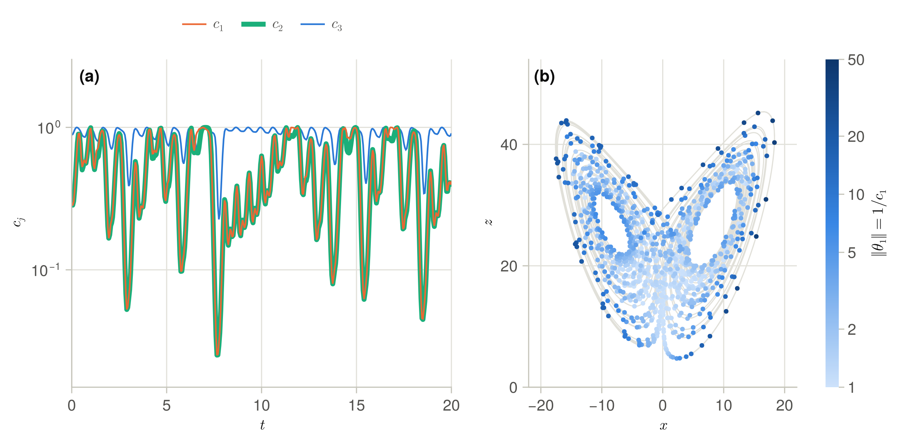
</p>

Panel (a) shows the three transversalities over the first 20 time units. The stable vector is close
to the normal to the plane of the other two most of the time, so that $c_1$ and $c_2$ nearly
coincide, both close to the sine of the angle between $\gamma_1$ and $\gamma_2$. Panel (b) shows the
length of the first adjoint CLV, the inverse of $c_1$, at the 1001 samples of the window, in the
plane $(x, z)$. The near tangencies are on the outer loops of the two lobes of the attractor, and
$c_1$ is below 0.1 at 7% of the samples.

### Projection of a perturbation

The components of a perturbation on the CLVs are its inner products with the adjoint CLVs.

```julia
julia> v = [1.0, 2.0, 3.0];

julia> Γ, Θ = Γs[1], Θs[1];

julia> a = [dot(Θ[j], v) for j in 1:3];

julia> norm(v .- sum(a[j] .* Γ[j] for j in 1:3))
1.5543122344752192e-15
```

The part of `v` along the unstable direction is `a[1] .* Γ[1]`, and what is left lies in the plane
of the neutral and stable vectors. The sign of each `a[j]` follows the orientation of the vectors.
With `N` smaller than the dimension of the system, the first `N` components are obtained in the same
way, and the remainder lies in the span of the CLVs that are not computed.

<p align="center">
  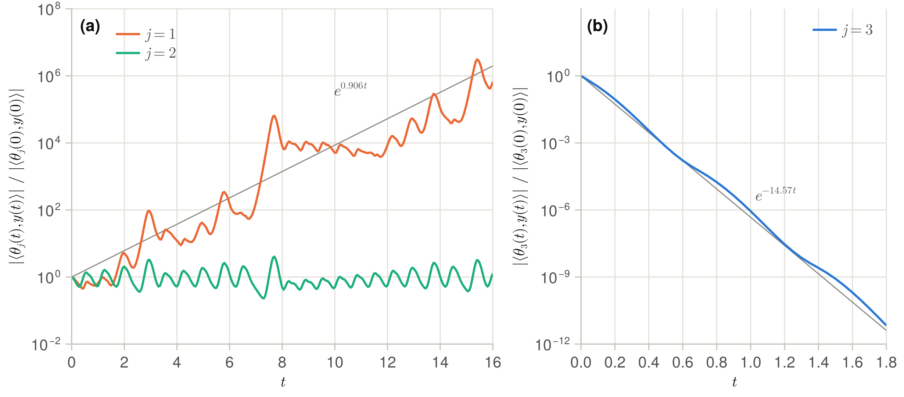
</p>

The figure shows the components of one perturbation $y(t)$, marched with the tangent flow from a
random vector at the start of the window, with $t$ measured from there. By the covariance of the two
families, the component $\langle \theta_j(t), y(t) \rangle$ is its value at $t = 0$ times the growth
factor $\mu_j(t, 0)$. Each component evolves by itself, and the adjoint CLVs separate them. The
first grows at the rate 0.84 over 16 time units, close to the first exponent, whose exponential is
the grey line, with the fluctuations of the growth over finite times. The second stays between 0.23
and 4.0, since its growth factor is the ratio of the speeds $\lVert f(u) \rVert$ at the two times.
The third decays as $e^{-14.57 t}$, and falls to rounding error relative to the perturbation in
about two time units.


## Choosing the parameters

### Number of vectors

The vectors $\gamma_j$ and $\theta_j$ need the first $j$ vectors of each set, so that `N` is the
index of the last vector wanted. The cost of the integrations grows as `N`, and that of the
re-orthonormalisations and of the recombination as $N^2$.

### Spin-up

The spans of the first $j$ vectors of each set converge as $e^{-(\lambda_j - \lambda_{j+1}) \tau}$
with the length $\tau$ of the spin-up. The vector $j$ of each family needs the span of the first $j$
vectors of its own set and that of the first $j - 1$ vectors of the other set, and converges at the
smaller of the gaps between $\lambda_j$ and the two exponents next to it. The smallest gap between
consecutive exponents among the first $N + 1$ therefore sets `tspin`, and the last vector depends on
the gap with the first exponent left out. For the Lorenz equations the smallest gap is 0.906, and a
spin-up of 25 time units leaves an error of about $10^{-9}$. Two exponents of equal value give a
plane rather than two vectors.

<p align="center">
  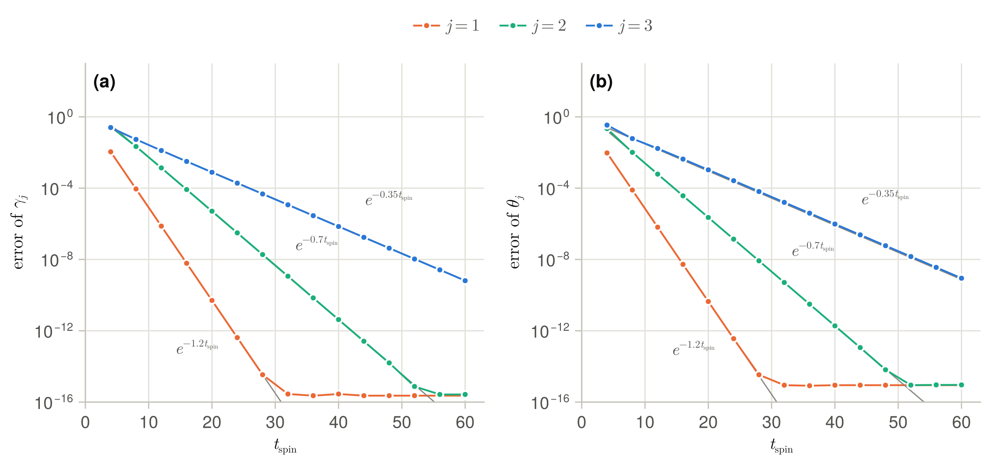
</p>

The figure shows the error of the first three vectors of each family against `tspin`, on the fixed
point of a linear system of dimension four, where the CLVs are the right eigenvectors of the matrix
and their adjoints the left ones. The exponents are 1, −0.2, −0.9 and −1.25, with gaps of 1.2, 0.7
and 0.35. The errors decay at the rates 1.20, 0.70 and 0.35, down to rounding error. The third
vector is set by the gap with the fourth exponent, which is not computed.

### Window and sampling

`oneevery` sets both the interval between two re-orthonormalisations and the sampling of the output.
Between two re-orthonormalisations the vectors of a set grow at different rates and tend to align
with the leading one, and they must be re-orthonormalised before the ratio between the growth of the
first and of the last approaches $10^{16}$. `T` must be a whole number of sampling intervals,
because the tangent set is sampled counting the time steps from the start of the window and the
adjoint set counting them from its end. Otherwise `computeCLV` throws an `ArgumentError`, after the
forward pass.

<p align="center">
  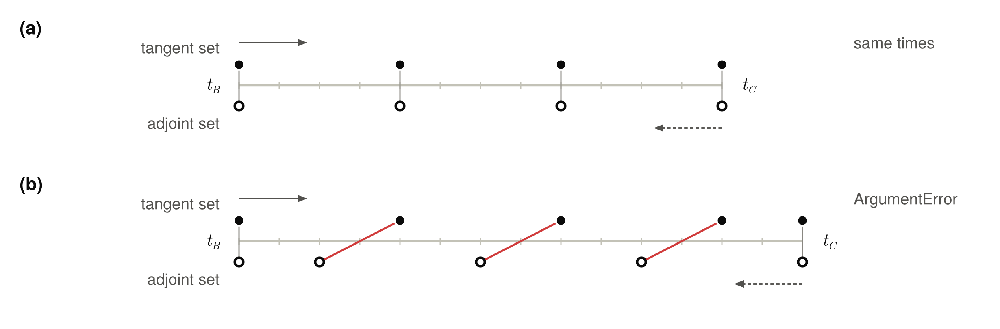
</p>

The figure shows the samples of the tangent set, the discs, and of the adjoint set, the rings, with
a sampling interval of four time steps. The last state of each pass is always saved. In panel (a)
the window is three sampling intervals long, and the two sets are sampled at the same times. In
panel (b) it is three and a half, and the samples that would be combined, joined in red, are at
different times.

### Memory

The samples of the two sets, $2N(K + 1)$ states, and the trajectory of the window at every time step
are held in memory. A larger `oneevery` reduces the first, and a shorter window both. The window is
not split in chunks, unlike the spin-ups, for which `Nsplits` bounds the stretch of trajectory in
memory. For a long window on a large system, the calculation can be repeated on consecutive windows.


## Accuracy

The duality of the two families is algebraic. It holds to rounding error whatever the accuracy of
the integrations, $7 \times 10^{-15}$ in the example above.

The covariance of the vectors holds for the discrete tangent and adjoint flows, provided that the
second is the transpose of the first. With RK4 in the continuous mode of Flows.jl this is the case,
since each step of the adjoint flow is the transpose of the step of the tangent flow over the same
stored trajectory. In the tests on the Lorenz equations the tangent flow maps each CLV onto its next
sample, and the adjoint flow each adjoint CLV onto its previous one, to $10^{-13}$. With a scheme
whose adjoint is the transpose of the tangent only up to the error of the time discretisation, this
error enters both families through $P$.

The vectors are those of the discrete flows, and differ from those of the differential equations by
the error of the time integration and of the interpolation of the trajectory, which is stored at
every time step and interpolated with Lagrange polynomials of degree three. Over the window of the
example above, the neutral CLV differs from the direction of the flow by at most $2 \times 10^{-5}$
with a time step of 0.005, by $2 \times 10^{-6}$ with 0.0025 and by $9 \times 10^{-8}$ with 0.00125,
the fourth order of the scheme.

The convergence of the two sets with the spin-up adds to these errors. In the example above, with a
spin-up of 25 time units, the first two vectors of each family computed with two and with three
vectors differ by less than $10^{-9}$.


## Limitations

- The Lyapunov exponents are not returned, although the re-orthonormalisations compute the growth of
  the vectors.
- The inner product must be real. `dot` and `norm` are used for Gram–Schmidt, for the matrix $P$ and
  for the normalisation, and the state type must also support `copy`, `similar` and broadcasting.
  The adjoint equations must be the adjoint of the tangent ones in `dot`.
- The trajectory of the window is held in memory at every time step, together with the samples of
  the two sets.
- `T` must be a whole number of sampling intervals, and this is checked only after the forward pass.
  The time steps of the tangent and of the adjoint flows are assumed equal, and are not compared.
- Exponents of equal value give a subspace but not individual vectors, and the LU factorisation
  without pivoting fails at an exact tangency between the CLVs.
- The time taken by each stage is always printed, and the state `x` is left at the last checkpoint.


## Tests

The tests run `computeCLV` on two systems. The first is the fixed point of a linear system of
dimension five, where the CLVs are the right eigenvectors of the matrix and the adjoint CLVs the
left ones, the columns of the inverse transpose of the matrix of the right eigenvectors. Both
families must match them to $10^{-8}$ and be dual to $10^{-12}$, with five vectors and with the
first three only, in which case the adjoint CLVs must still be dual to all the five CLVs. A window
that is not a whole number of sampling intervals must be rejected.

The second is a chaotic trajectory of the Lorenz equations, where the vectors are not known in
closed form. The tests check the properties that define them, with integrations that `computeCLV`
does not use. Over each sampling interval the tangent flow must map each CLV onto its next sample,
and the adjoint flow each adjoint CLV onto its previous sample, with the same growth factor, to
$10^{-10}$. The two families must be dual, the neutral CLV must be the direction of the flow to the
error of the time discretisation, and the first two vectors of each family must not depend on the
number of vectors computed. A last test checks `angles` on three vectors of the plane. Run the tests
with

```
julia --project -e 'using Pkg; Pkg.test()'
```


## Reproducing the figures

The diagrams of this manual are drawn by `examples/make_diagrams.jl`, with exact geometry and no
integration. The figures with results come from `examples/make_figures.jl`, which also prints every
number quoted about the example on the Lorenz equations, about the accuracy and about the
convergence with the spin-up. The two scripts share an environment, with CairoMakie and with
Flows.jl from GitHub, and the colours and theme of the figures in `examples/style.jl`. From the root
of the repository, run

```
julia --project=examples -e 'using Pkg; Pkg.instantiate()'
julia --project=examples examples/make_diagrams.jl
julia --project=examples examples/make_figures.jl
```

Each script takes about a minute, most of it to load CairoMakie. The logo is drawn by
`assets/make_logo.jl`, run with `julia assets/make_logo.jl`. Its portrait of Aleksandr Lyapunov,
`assets/lyapunov.png`, is a photograph in the public domain with the background removed. It was
published in 1908 by I. P. Osipov and D. I. Bagalei in the history of the Faculty of Physics and
Mathematics of the University of Kharkiv, and is taken from
[Wikimedia Commons](https://commons.wikimedia.org/wiki/File:Aleksandr_Lyapunov.jpg).


## References

- G. Benettin, L. Galgani, A. Giorgilli and J.-M. Strelcyn, Lyapunov characteristic exponents for
  smooth dynamical systems and for Hamiltonian systems; a method for computing all of them. Part 1:
  Theory, Meccanica 15, 9–20 (1980), [doi:10.1007/BF02128236](https://doi.org/10.1007/BF02128236).
- F. Ginelli, P. Poggi, A. Turchi, H. Chaté, R. Livi and A. Politi, Characterizing dynamics with
  covariant Lyapunov vectors, Phys. Rev. Lett. 99, 130601 (2007),
  [doi:10.1103/PhysRevLett.99.130601](https://doi.org/10.1103/PhysRevLett.99.130601).
- P. V. Kuptsov and U. Parlitz, Theory and computation of covariant Lyapunov vectors, J. Nonlinear
  Sci. 22, 727–762 (2012),
  [doi:10.1007/s00332-012-9126-5](https://doi.org/10.1007/s00332-012-9126-5).
- C. L. Wolfe and R. M. Samelson, An efficient method for recovering Lyapunov vectors from singular
  vectors, Tellus A 59, 355–366 (2007),
  [doi:10.1111/j.1600-0870.2007.00234.x](https://doi.org/10.1111/j.1600-0870.2007.00234.x).
